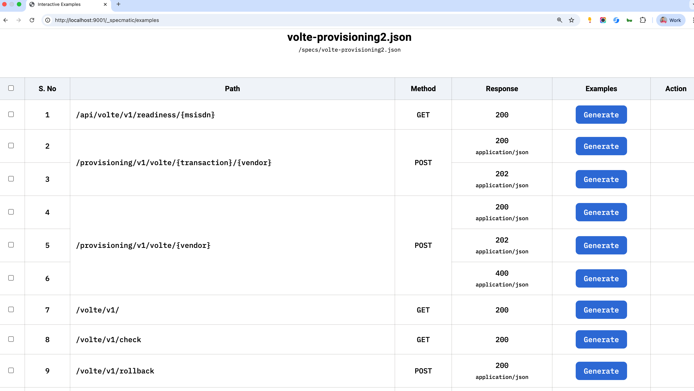
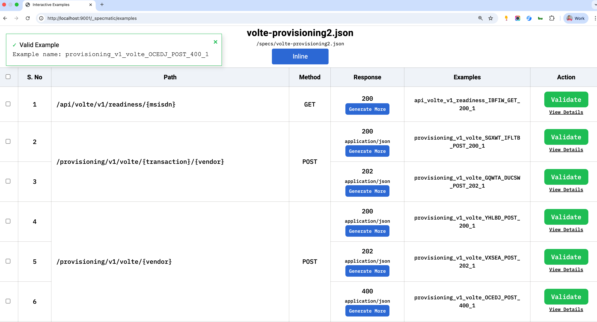

# Specmatic Contract Testing - Quick Start Guide

## ✨ Overview

Specmatic helps you test your APIs against OpenAPI contracts, ensuring your service implementation adheres to the agreed
contract. This enables safe, predictable, and consumer-friendly API evolution.

## ✅ 1. Install Specmatic

### Option A: Download the JAR

Download the latest standalone JAR from GitHub Releases:

```
https://github.com/znsio/specmatic/releases/latest
```

Rename for convenience:

```
mv specmatic-*.jar specmatic.jar
```

Run as Docker Container:

```shell
docker run specmatic/specmatic proxy --target=http://localhost:8080 ./testing
```

## 📄 2. Prepare Your OpenAPI Contract

Ensure your service has a valid OpenAPI 3.x specification file (YAML or JSON). This will be used to validate service
implementation.

Example:

```
contract.yaml
```

## 🧺 3. Run Specmatic as a Proxy (Optional)

To validate real-time traffic against the contract:

```
java -jar specmatic.jar proxy --target=http://localhost:8080 ./testing
```

Specmatic will intercept calls and ensure all requests and responses match the contract.

## 📟 4. Use Specmatic Examples UI to Interactively Validate

Run the interactive UI to explore test cases auto-generated from the contract:

```
 docker run --rm -v "$(pwd):/specs" -p "9001:9001" znsio/specmatic-openapi examples interactive --spec-file /specs/api.json
```

Then open your browser:

```
http://localhost:9001/_specmatic/examples
```

Interactive UI





You can:

- View contract-based request/response examples
- Modify and execute them
- Visually validate your service's adherence to contract

## 🚪 5. Run Contract Tests Against the Live Provider

Validate that the actual service implementation conforms to the OpenAPI spec:

```
docker run -v "$(pwd)/api.json:/api.json" specmatic/specmatic test "/api.json" --testBaseURL=localhost:8080
```

### Optional: Add Logging

```
--log
```

### Sample Output

```
Validating GET /users
✔ Passed

Validating POST /users
❌ Failed: Status code mismatch. Expected 201, got 400
```

## 📌 Summary

| Task               | Command            |
|--------------------|--------------------|
| Run as proxy       | specmatic proxy    |
| Open Examples UI   | specmatic examples |
| Run contract tests | specmatic test     |

## 📙 Resources

- [Specmatic Docs](https://specmatic.in)
- [GitHub](https://github.com/znsio/specmatic)